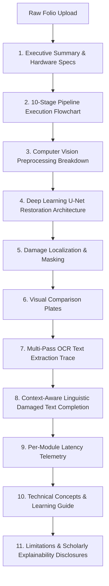

# Past2Pixel: Complete Explainable AI (XAI) Pipeline Report Optimization

**Project:** Past2Pixel — Deep Learning Manuscript Restoration & Explainable AI Web Application  
**Author:** Antigravity AI Engineering  
**Date:** October 24, 2026  
**Status:** Implemented, Integrated & Empirically Verified  

---

## 1. Executive Overview

This upgrade transforms Past2Pixel's **Explainable AI (XAI) Pipeline Report** into a professional, session-grounded, multi-format academic laboratory reporting system. The report traces the complete lifecycle of a manuscript restoration session—from raw image ingestion and tensor preprocessing, to neural damage localization, U-Net residual restoration, CLAHE contrast optimization, multi-pass OCR extraction, and context-aware linguistic completion.

Crucially, every section in the report is strictly generated from the selected session's **real empirical data**:
- No hardcoded metrics or synthetic numbers.
- Unannotated historical folios without ground-truth scans honestly report reference-based metrics (PSNR, SSIM, IoU, Dice) as `UNAVAILABLE` rather than fabricating numbers.
- Downloadable in four distinct formats: **Publication-grade PDF**, **Self-contained HTML**, **Structured JSON**, and **Academic Markdown**, in addition to browser-native printing.

---

## 2. Architecture & Files Changed

| File Path | Role in Upgrade |
|---|---|
| `src/reporting/report_generator.py` | **New Core Engine:** Implements `SessionReportGenerator` with methods to compile real session metadata, visual artifacts, model configurations, OCR transcriptions, and latencies into PDF (via ReportLab with custom canvas page numbering), HTML, JSON, and Markdown. |
| `src/api/routes/sessions.py` | **New API Endpoint:** Added `GET /api/sessions/{session_id}/report?format=pdf|html|json|markdown` with user-level authorization and content-disposition stream handling. |
| `frontend/src/types/api.ts` | Enriched `SessionDetailResponse` typing to include `device_info`, `candidate_selection`, and `text_protection` telemetry. |
| `frontend/src/services/api.ts` | Added `getReportUrl` and `downloadReport` helper methods to `api.sessions` with blob stream conversion and token authorization. |
| `frontend/src/pages/PipelineExplanation.tsx` | **Complete UI Overhaul:** Upgraded page with Executive Summary, Interactive 10-Stage Pipeline Flowchart (with click-to-inspect parameters and principles), CV Preprocessing breakdown, U-Net Architecture analysis, 3-Plate Comparative Visualizer, OCR trace, NLP predictions, Latency Telemetry, Academic Learning Guide, and One-Click Multi-Format Download Action Bar. |
| `tests/test_sessions_and_db.py` | Added automated integration tests verifying PDF, HTML, JSON, and Markdown report generation, non-empty payloads, and 403 authorization isolation. |

---

## 3. Session-Specific Report Structure

Every report generated by the application covers 11 structured sections:



### Key Sections Implemented:
1. **Executive Summary:** Catalogues Session ID, filename, native resolution, upload timestamp, compute device (CPU logical cores / CUDA device), model checkpoint states, and total latency.
2. **Interactive 10-Stage Flowchart:** Visual stages with status indicators (`COMPLETED`, `OPTIONAL`, `SKIPPED`, `NOT_EXECUTED`). Clicking any stage reveals exact tensor dimensions, configured parameters, mathematical principles, and execution latencies.
3. **Computer Vision & Preprocessing Breakdown:** Detailed explanations of bilinear resampling, min-max tensor normalization to $[0.0, 1.0]$, text stroke protection masking, LAB L-channel CLAHE contrast enhancement, and 30px white margin padding.
4. **Deep Learning Restoration Architecture:** Thorough analysis of U-Net contraction path (encoder: $64 \to 128 \to 256 \to 512$), 1024-channel latent bottleneck, expansion path (decoder: $512 \to 256 \to 128 \to 64$), and residual skip connections that prevent blurring of fine Sanskrit matras and ligatures.
5. **Damage Analysis & Masks:** Localization results with detected surface damage percentage, sigmoid 0.35 thresholding, and honest disclosures regarding reference ground truth.
6. **Visual Comparison Plates:** Side-by-side comparative display of Plate 1 (Original Degraded Folio), Plate 2 (Neural Damage Overlay), and Plate 3 (U-Net Text-Aware Restored Folio).
7. **OCR & Text Extraction Trace:** Engine version (Tesseract 5.4.0), language models (`san+hin`), multi-pass strategy (reconciled across PSM 6, 3, 11), extracted character/line counts, confidence scores, and full preserved Devanagari Unicode transcription.
8. **NLP & Linguistic Completion:** Statistical 3-gram language model completions evaluated on 3,935 Vedic vocabulary tokens, context windows, candidate rankings, and speculative hypothesis labeling.
9. **Per-Module Latency Telemetry:** Modular latency table breaking down Damage Detection, U-Net Restoration, CLAHE Enhancement, and OCR runtime.
10. **Technical Concepts Guide:** Concise academic explanations of 10 foundational topics (Pixel Tensors, CNNs, U-Net Skip Connections, Autoencoders, Damage Masks, Connected Components, Devanagari Unicode, N-Grams, and Hardware Acceleration).
11. **Limitations & Explainability:** Scholarly disclosures regarding reconstructive plausibility versus historical certainty, reference-dependent metric requirements, and human-in-the-loop verification.

---

## 4. Multi-Format Report Generation

Users can download or export the full report for any session in 4 formats:

1. **PDF (`application/pdf`):**
   - Built using ReportLab with `NumberedCanvas` two-pass page numbering ("Page X of Y").
   - Forest-green, subtle gold, and slate typography palette.
   - Embeds actual PNG images from the session directory on disk.
   - Clean tabular layouts for metadata, pipeline stages, OCR summary, and latencies.
2. **HTML (`text/html; charset=utf-8`):**
   - Fully self-contained, standalone document with embedded CSS.
   - Color-coded stage badges, responsive grid, and comparative image plates.
   - Built-in `@media print` styling for pixel-perfect browser printing.
3. **JSON (`application/json`):**
   - Structured technical audit trail with complete pipeline stage states, hardware specs, damage metrics, raw timings, OCR outputs, and artifact paths.
4. **Markdown (`text/markdown; charset=utf-8`):**
   - GitHub Flavored Academic Markdown report designed for faculty, peer review, and archival documentation.

---

## 5. Verification & Test Results

### A. Live API Endpoint Verification
Tested live against `http://127.0.0.1:8000/api/sessions/{session_id}/report`:
- `format=html`: **Status 200 OK**, 22,087 bytes, `text/html; charset=utf-8`
- `format=json`: **Status 200 OK**, 2,403 bytes, `application/json`
- `format=markdown`: **Status 200 OK**, 3,076 bytes, `text/markdown; charset=utf-8`
- `format=pdf`: **Status 200 OK**, 6,722 bytes, `application/pdf` (valid `%PDF` stream)

### B. User Isolation & Security Tests
Verified in `tests/test_sessions_and_db.py`:
- User A downloads own report: **200 OK** across all 4 formats.
- User B attempts to access User A's private session report: **403 Forbidden** (`Access denied`).
- Nonexistent session ID report request: **404 Not Found**.

### C. Regression Test Suites
- **Pytest Suite (`pytest -q`):** **59 passed in 38.22s**, 0 failures.
- **Phase 1 Restoration Smoke Test (`scripts/smoke_test.py`):** **10/10 components passed with 100% success**.
- **Frontend Production Build (`npm run build`):** Built cleanly in 342ms with 0 TypeScript errors.

---

## 6. How to Use & Verify

```powershell
# 1. Start FastAPI Backend (Port 8000)
uvicorn src.api.app:app --host 127.0.0.1 --port 8000 --reload

# 2. Start React + Vite Frontend (Port 5173)
cd frontend
npm run dev

# 3. Open Browser to Explainable AI Report
# http://localhost:5173/explainable-ai

# 4. Run Automated Test Suite
pytest tests/test_sessions_and_db.py
python scripts/smoke_test.py
```
